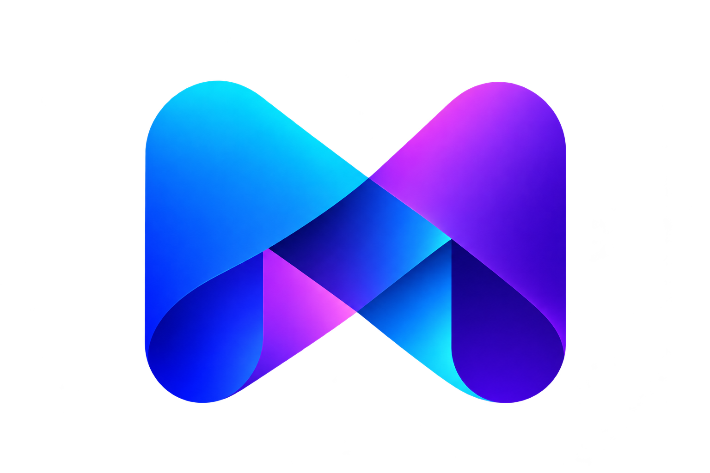

<div align="center">



# Mimic UI

**A UI library that moves into your codebase.**

Choose a visual theme, copy the components you need, and shape them for your product.
No runtime package. No injected stylesheet.

[Documentation](apps/docs/README.md) · [CLI](#cli) · [Themes](#themes)

</div>

## What is Mimic UI?

Mimic UI is a framework-aware component registry and command line tool. It follows a copy-into-your-project workflow: component source belongs to your application and can be edited directly. Themes define component appearance and structure. The library does not add global CSS to projects.

This repository is an MVP foundation. Theme and framework directories are ready for implementations; the registry currently ships no components.

## Quick start

Requires Node.js 18 or newer. Clone this repository, install dependencies, then run the local CLI from the project you want to configure:

```sh
npm install
cd path/to/your-project
node path/to/mimic_ui/packages/cli/src/index.js init
```

The CLI asks for your framework, visual theme, and whether you plan to add all available components or pick them individually. It writes `mimic.json`. The registry is currently empty, so `list` and `add` explain that no components have been published yet.

Framework targets planned for the registry: React, Angular, Vue, Svelte, and React Native. A target is a planned slot, not a claim that implementations already exist.

## Configuration

```json
{
	"$schema": "https://mimic-ui.dev/schema.json",
	"theme": "classic",
	"framework": "react",
	"components": "src/components/ui",
	"utils": "src/lib/mimic.ts",
	"installMode": "individual"
}
```

`theme` selects the source variation. `framework` selects its framework implementation. `components` is the destination for copied files. `utils` is reserved for future helper generation; the CLI does not generate utilities or styles yet.

## Themes

- **Classic** — a familiar, balanced foundation.
- **Studio** — a more expressive design direction.
- **Minimal** — a restrained visual language.

These are names and extension points. Add authored component source under `registry/themes/<theme>/<framework>/`, then make completed files available to the CLI in `packages/cli/templates/components/`.

## CLI

From the repository root:

```sh
npm run cli -- init
npm run cli -- list
npm run cli -- add button
```

After publishing `@mimic-ui/cli` to npm, the equivalent consumer commands will be:

```sh
npx @mimic-ui/cli init
npx @mimic-ui/cli list
npx @mimic-ui/cli add button
```

To publish a component, add its copyable source to `packages/cli/templates/components/<theme>/<framework>/` and register it in `packages/cli/templates/registry.json`. Keep components self-contained and avoid global CSS. Do not register a framework/theme pair until its implementation exists.

## Repository layout

```text
apps/docs/                 Documentation website
packages/cli/              CLI and copyable source registry
registry/themes/            Authoring space for theme implementations
templates/                  Future starter projects
.cursor/rules/              Cursor project guidance
.claude/rules/              Claude project guidance
```

## Development

```sh
npm install
npm run cli -- --help
npm run docs:dev
npm run format
npm run format:check
```

`npm run format` formats project source with Prettier using tabs and a four-column tab width. Formatting configuration is centralized at the repository root.

## Roadmap

1. Build and document component implementations for each theme and framework.
2. Add registry metadata, dependency declarations, and safe file conflict handling.
3. Add framework detection and framework-specific starter templates.
4. Add searchable docs pages with live examples as components become available.
5. Add React Native component guidance and examples.

## Contributing

See [CONTRIBUTING.md](CONTRIBUTING.md), [GOVERNANCE.md](GOVERNANCE.md), and [CODE_OF_CONDUCT.md](CODE_OF_CONDUCT.md).

## License

MIT. See [LICENSE](LICENSE).
